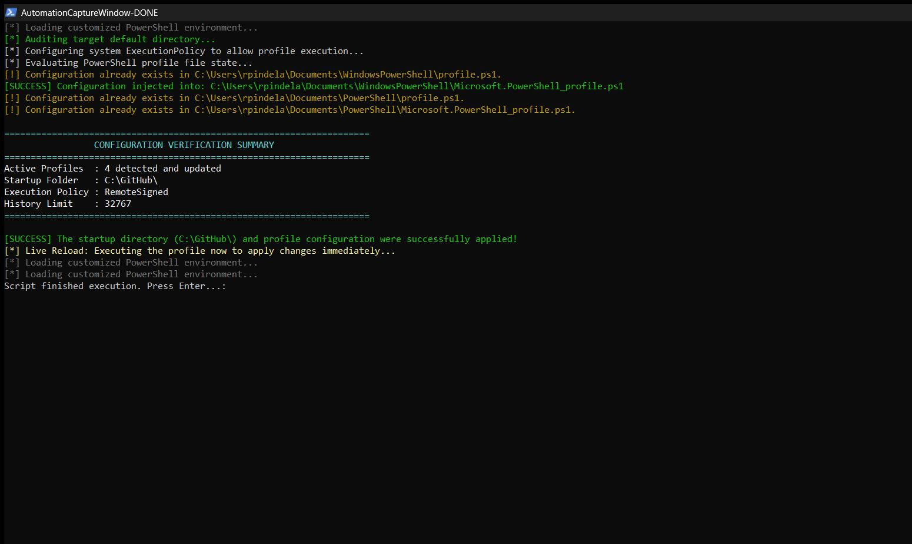
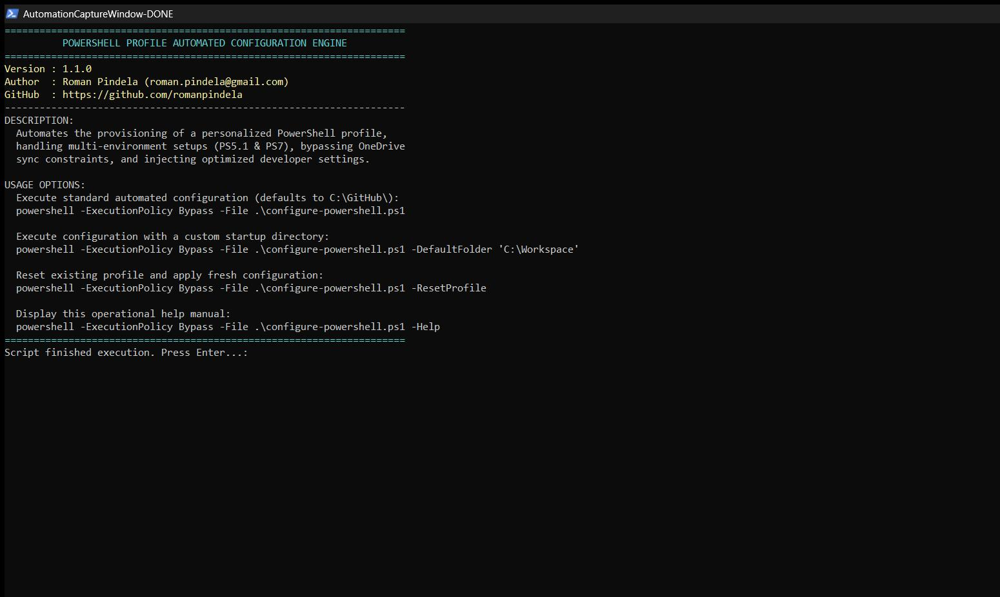

# Configure-PowerShell

## Problem Statement

Fresh Windows installations start PowerShell in user profile directories with restrictive default execution policies, no persistent startup workspace, minimal history retention, and unconfigured prediction options—requiring manual setup across both Windows PowerShell 5.1 and PowerShell 7+ profile paths (including OneDrive-redirected `Documents` folders).

## Overview

`Configure-PowerShell.ps1` initializes PowerShell profiles for both Windows PowerShell 5.1 and PowerShell 7+, ensures the default workspace folder exists (`C:\GitHub\` by default), sets `CurrentUser` execution policy to `RemoteSigned`, configures `PSReadLine` history prediction (`PredictionSource History`, cursor-to-end, `BellStyle None`, `$MaximumHistoryCount = 32767`), and dot-sources the active `$PROFILE` immediately.

## Environment & Prerequisites

- **OS:** Windows 10, Windows 11, or Windows Server
- **PowerShell:** Windows PowerShell 5.1 or PowerShell 7+
- **Dependencies:** Built-in `PSReadLine` module (no external installations required)

## Permissions Required

**User** — Sets `ExecutionPolicy` at the `CurrentUser` scope and modifies only current user profile files and `-DefaultFolder`. No Administrator privileges are required.

## Safety & Impact

- **Risk Level:** `Modifies user configuration & local directories` — Creates `-DefaultFolder` if missing, sets `CurrentUser` execution policy to `RemoteSigned`, creates missing PowerShell 5.1 / 7+ profile files, and appends startup configuration (idempotently checking for existing markers). Passing `-ResetProfile` clears existing content (`Clear-Content`) from all detected target profiles before writing.
- **WhatIf / Confirm & Backup:** Does not support `-WhatIf` / `-Confirm` and creates no backups before `-ResetProfile` clears profile files.

## Usage Examples

```powershell
# Display built-in help
powershell -ExecutionPolicy Bypass -File .\Configure-PowerShell.ps1 -Help

# Display PowerShell Comment-Based Help
Get-Help .\Configure-PowerShell.ps1 -Full

# Configure profiles with default startup directory (C:\GitHub\)
powershell -ExecutionPolicy Bypass -File .\Configure-PowerShell.ps1

# Configure profiles with a custom startup directory
powershell -ExecutionPolicy Bypass -File .\Configure-PowerShell.ps1 -DefaultFolder "C:\GitHub\Workspace"

# Reset existing profiles and apply fresh configuration
powershell -ExecutionPolicy Bypass -File .\Configure-PowerShell.ps1 -ResetProfile
```

### Arguments

| Argument | Type | Description | Required | Default |
| :--- | :--- | :--- | :---: | :--- |
| `-DefaultFolder` | `[string]` | Defines the absolute path to your default development directory. | No | `C:\GitHub\` |
| `-Help` | `[switch]` | Displays the script's operational manual. | No | `$false` |
| `-ResetProfile` | `[switch]` | Safely wipes existing configurations from all detected profiles before applying fresh settings. | No | `$false` |

## Execution View

### Standard Run


### Help Output (-Help)


## Author

- **Roman Pindela**
- **Email:** [roman.pindela@gmail.com](mailto:roman.pindela@gmail.com)
- **GitHub:** [https://github.com/romanpindela](https://github.com/romanpindela)
- **Version:** `1.1.0`
- **License:** MIT
