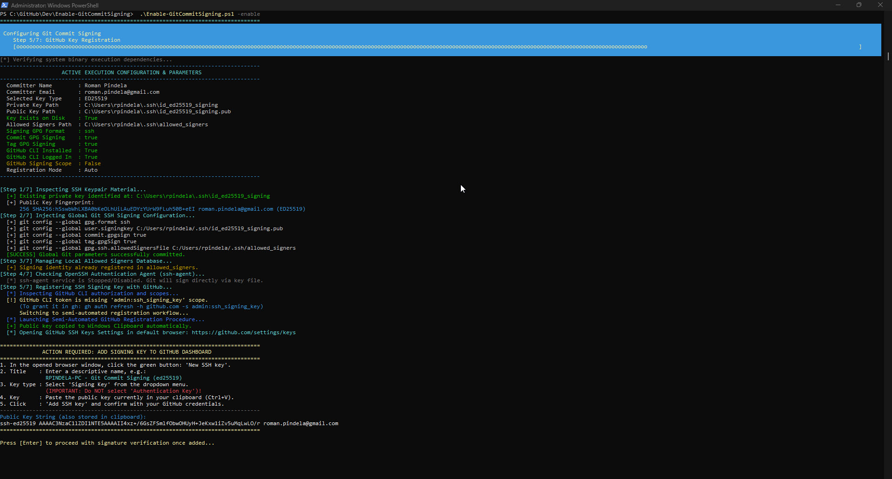
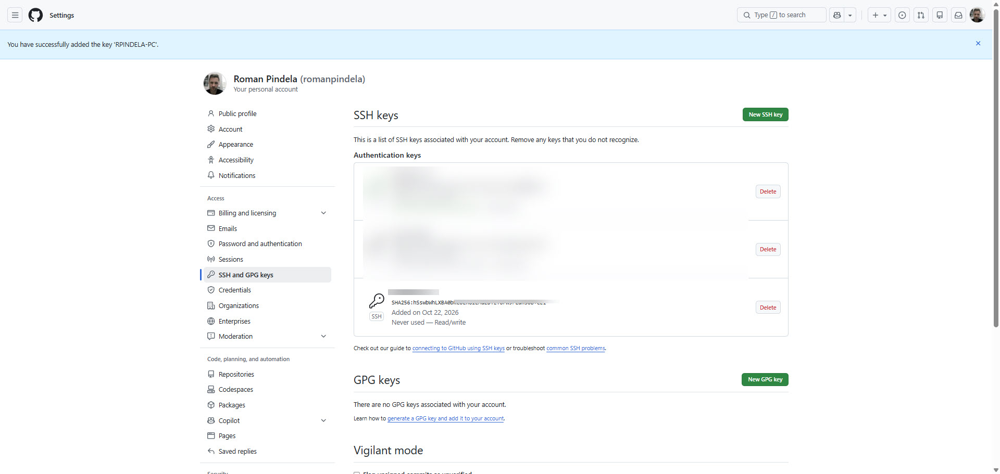

# Enable-GitCommitSigning 🔏

[](https://opensource.org/licenses/MIT)
[]()
[]()
[]()
[]()

## Problem Statement

Cryptographically signing Git commits and tags with traditional GPG/PGP toolchains requires installing external suites (such as GnuPG/Gpg4win), managing key expirations, and troubleshooting pinentry dialogs. While Git 2.34+ supports native OpenSSH commit signing, manually generating signing keys, configuring Git global settings, populating `allowed_signers`, starting `ssh-agent`, and registering signing keys on GitHub is multi-step and error-prone.

## Overview

`Enable-GitCommitSigning.ps1` automates end-to-end SSH commit and tag signing on Windows. It generates or reuses an Ed25519/RSA SSH keypair, configures global Git signing variables (`gpg.format = ssh`, `user.signingkey`, `commit.gpgsign`, `tag.gpgSign`, `gpg.ssh.allowedSignersFile`), maintains `~/.ssh/allowed_signers`, optionally enables `ssh-agent`, registers the signing key on GitHub via `gh` CLI or browser/clipboard fallback, runs a local signature sandbox test, and includes a `-Push` pipeline with `Write-Progress` bars.

## Environment & Prerequisites

| Component | Minimum Requirement | Notes |
| :--- | :--- | :--- |
| **Operating System** | Windows 10 (1809+), Windows 11, Windows Server 2016+ | x64 / ARM64 architectures supported |
| **PowerShell** | Windows PowerShell 5.1 or PowerShell 7+ | Execution policy `RemoteSigned` or `Bypass` |
| **Git Engine** | [Git for Windows](https://git-scm.com/) **2.34.0+** | Required for native SSH signing support |
| **OpenSSH** | OpenSSH for Windows (`ssh-keygen.exe`, `ssh-add.exe`) | Included natively with Windows 10/11 |
| **GitHub CLI** | [GitHub CLI](https://cli.github.com/) (`gh.exe`) | *Optional* for automated key registration (`-RegistrationMode Auto`) |

## Permissions Required

**User (Admin optional)** — Runs in standard user context for key generation, global `.gitconfig` updates, `allowed_signers` management, GitHub registration, sandbox commit testing, and `-Push`. **Administrator privileges are only required optionally** when using `-ConfigureAgent` on a system where the Windows `ssh-agent` service is disabled/stopped and needs its startup type set to `Automatic` (`Set-Service -Name ssh-agent -StartupType Automatic`).

## Safety & Impact

- **Risk Level:** `Modifies local configuration, SSH keys, and optionally remote GitHub state` — Generates SSH keys (`~/.ssh/id_ed25519_signing` by default if missing), modifies global Git configuration, appends to `~/.ssh/allowed_signers`, optionally registers a signing key on GitHub, and with `-Push` stages, signs, and pushes commits to `origin`.
- **WhatIf / Confirm & Logs:** Does not support `-WhatIf` / `-Confirm` and creates no configuration backups. Running without parameters or with `-Help` executes safely without modifying state. Writes timestamped UTF-8 audit logs by default to `$HOME\.git-commit-signing\logs\` (unless `-NoLog` is specified).

## Usage Examples

### Example 1: Display Help & Usage Manual (Empty-Run)
```powershell
.\Enable-GitCommitSigning.ps1
# Or explicitly:
.\Enable-GitCommitSigning.ps1 -Help

# PowerShell Comment-Based Help:
Get-Help .\Enable-GitCommitSigning.ps1 -Full
```

### Example 2: Complete Automatic Setup (Recommended)
Generates a dedicated `id_ed25519_signing` key, configures global Git variables, creates `allowed_signers`, registers the key via GitHub CLI (`gh`), and tests the signature:
```powershell
.\Enable-GitCommitSigning.ps1 -Enable
```

### Example 3: Use Existing SSH Key (`~/.ssh/id_ed25519`)
```powershell
.\Enable-GitCommitSigning.ps1 -Enable -UseExistingKey
```

### Example 4: Semi-Automated Web Portal Registration
Copies the public key to the clipboard and opens `https://github.com/settings/keys` in your browser:
```powershell
.\Enable-GitCommitSigning.ps1 -Enable -RegistrationMode Manual
```

### Example 5: Enable OpenSSH Agent Service & Run Cryptographic Sandbox Test
```powershell
.\Enable-GitCommitSigning.ps1 -Enable -ConfigureAgent -TestCommit
```

### Example 6: Ship Signed Changes to Remote with Real-Time Progress Bar
```powershell
.\Enable-GitCommitSigning.ps1 -Push -RepoPath "C:\Dane\rpindela\GitHub\Dev" -CommitMessage "feat: implement cryptographic commit signing"
```

---

## Parameter Reference

| Parameter | Aliases | Type | Default Value | Description |
| :--- | :--- | :--- | :--- | :--- |
| `-Enable` | `-e`, `-Setup`, `-Init` | Switch | `$false` | Triggers the complete end-to-end Git commit signing onboarding pipeline. |
| `-UseExistingKey` | `-Existing` | Switch | `$false` | Detects and uses the primary existing SSH key (`~/.ssh/id_ed25519`). |
| `-KeyPath` | `-k`, `-Key` | String | `~/.ssh/id_ed25519_signing` | Custom path to the SSH private key. |
| `-KeyType` | *(none)* | String | `ed25519` | Key algorithm: `ed25519` or `rsa`. |
| `-KeyTitle` | `-t`, `-Title` | String | `<Host> - Git Commit Signing` | Descriptive title for the key in GitHub account settings. |
| `-Email` | *(none)* | String | *(from git config)* | Committer email address mapped to GitHub account. |
| `-Name` | *(none)* | String | *(from git config)* | Full committer display name. |
| `-AllowedSignersFile` | *(none)* | String | `~/.ssh/allowed_signers` | Local database file for cryptographic signature verification. |
| `-RegistrationMode` | *(none)* | String | `Auto` | GitHub key upload mode: `Auto`, `Manual`, or `Prompt`. |
| `-ConfigureAgent` | `-Agent` | Switch | `$false` | Configures and starts the Windows `ssh-agent` service and adds the key. |
| `-TestCommit` | `-Test` | Switch | `$false` | Runs an isolated sandbox commit test verifying cryptographic signing. |
| `-RepoPath` | `-p`, `-Path` | String | *(Current Directory)* | Path to a target Git repository for local configuration or file shipping. |
| `-Push` | `-Ship` | Switch | `$false` | Stages, cryptographically signs, and pushes changes with a progress bar. |
| `-CommitMessage` | `-m`, `-Message` | String | *(Default message)* | Custom commit message when `-Push` is invoked. |
| `-LogPath` | `-l`, `-Log` | String | `~/.git-commit-signing/logs/` | Custom file path for execution logging. |
| `-NoLog` | *(none)* | Switch | `$false` | Disables disk file logging (console output remains active). |
| `-Help` | `-h` | Switch | `$false` | Displays the help guide and author information. |

---

## Directory Structure

```text
C:\Dane\rpindela\GitHub\Dev\
│
├── Enable-GitCommitSigning\
│   ├── assets/
│   │   ├── Standard_run.jpg                           # Empty-run help guide view
│   │   ├── Adding_new_ssh_key_to_github_account.jpg   # GitHub SSH signing key registration dialog
│   │   ├── Adding_new_ssh_key_to_github_account2.jpg  # GitHub SSH keys overview dashboard
│   │   └── Success.jpg                                # Full execution and signature verification view
│   ├── Enable-GitCommitSigning.ps1                    # Main production automation script
│   └── README.md                                      # Documentation (this file)
└── README.md                                          # Dev repository index
```

---

## GitHub Key Registration Modes

### Automated Registration (GitHub CLI)
When `-RegistrationMode Auto` is selected (default), the script inspects your active GitHub CLI session:
1. Verifies that `gh.exe` is authenticated (`gh auth status`).
2. Checks if your token has the `admin:ssh_signing_key` OAuth scope.
3. Automatically executes:
   ```powershell
   gh ssh-key add "$HOME\.ssh\id_ed25519_signing.pub" --title "PC - Git Commit Signing" --type signing
   ```
4. If the key is already registered, it detects the duplicate and confirms key validity.

### Semi-Automated Registration (Web Portal + Clipboard)
If GitHub CLI is not installed, lacks the signing scope, or `-RegistrationMode Manual` is chosen:
1. The public key is copied to the Windows Clipboard (`Set-Clipboard` / `clip.exe`).
2. Your default web browser opens directly to `https://github.com/settings/keys`.
3. Follow the displayed instructions to add the key as a **Signing Key** (not *Authentication Key*).



---

## Local Signature Verification (`allowed_signers`)

GitHub validates SSH signatures on its web platform, while local verification (`git log --show-signature`) requires a local `allowed_signers` file at `C:\Users\<Username>\.ssh\allowed_signers` mapped via:

```powershell
git config --global gpg.ssh.allowedSignersFile "C:/Users/<Username>/.ssh/allowed_signers"
```

---

## File Shipping Pipeline with Progress Bar (`-Push`)

- **Phase 1 (20%):** Scans for modified and untracked files (`git status --porcelain`).
- **Phase 2 (40%):** Stages changes (`git add -A`).
- **Phase 3 (60%):** Creates a cryptographically signed commit (`git commit -S -m ...`).
- **Phase 4 (80%):** Pushes to remote (`git push origin <branch> --progress`).
- **Phase 5 (100%):** Verifies the latest commit signature (`git log --show-signature -1`).

---

## Event Logging

- **Default Log Location:** `$HOME\.git-commit-signing\logs\commit-signing-YYYYMMDD-HHmmss.log`
- **Custom Log Path:** Pass `-LogPath "C:\MyLogs\signing.log"` to direct logs to a specific file, or `-NoLog` to disable file logging.

---

## Troubleshooting & FAQ

- **GitHub shows "Unverified":** Ensure the key is added as a **Signing Key** at `https://github.com/settings/keys` and `git config user.email` matches a verified email on your GitHub account.
- **`ssh-agent` fails to start:** Run PowerShell as Administrator once and run `Set-Service -Name ssh-agent -StartupType Automatic; Start-Service -Name ssh-agent` (Git SSH signing still works directly via the key file even if `ssh-agent` is stopped).
- **Verify active config:** Run `git config --list --show-origin` and confirm `gpg.format=ssh`, `user.signingkey`, `commit.gpgsign=true`, `tag.gpgsign=true`, and `gpg.ssh.allowedsignersfile`.

---

## Security & Script Unblocking

```powershell
Unblock-File -Path .\Enable-GitCommitSigning.ps1
```

---

## Screenshots & Visual Walkthrough

### 1. Interactive Help Menu & Metadata (Empty-Run Safeguard)


### 2. GitHub Web Portal - Registering Signing Key


### 3. GitHub SSH Keys Dashboard Overview


### 4. Successful End-to-End Execution & Signature Verification


---

## Author

- **Roman Pindela**
- **Email:** [roman.pindela@gmail.com](mailto:roman.pindela@gmail.com)
- **GitHub:** [https://github.com/romanpindela](https://github.com/romanpindela)
- **Repository:** [https://github.com/romanpindela/Dev](https://github.com/romanpindela/Dev)
- **Version:** `1.0.0`
- **Release Date:** October 2026
- **License:** MIT
