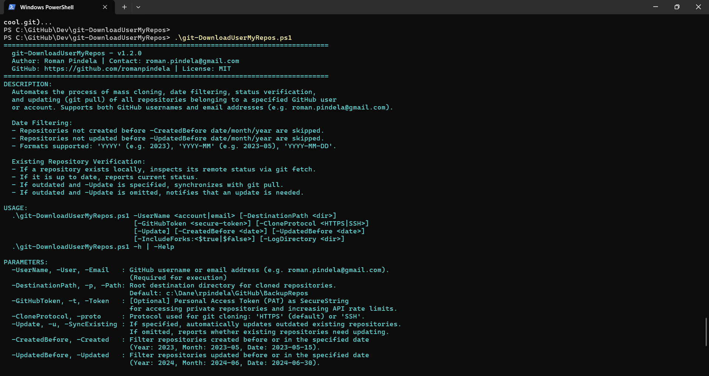
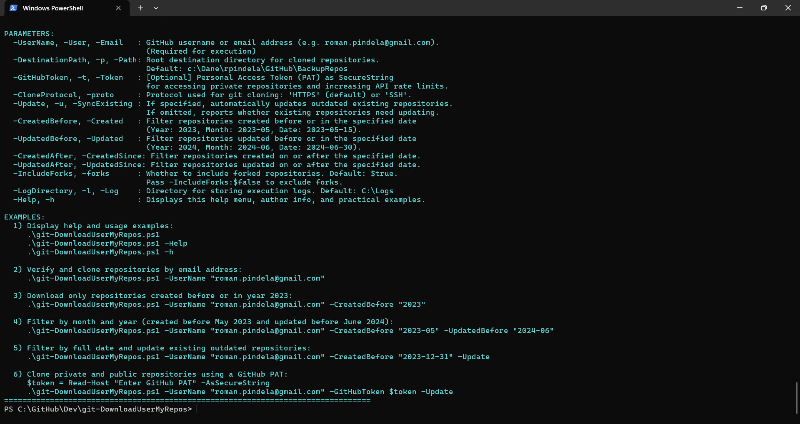
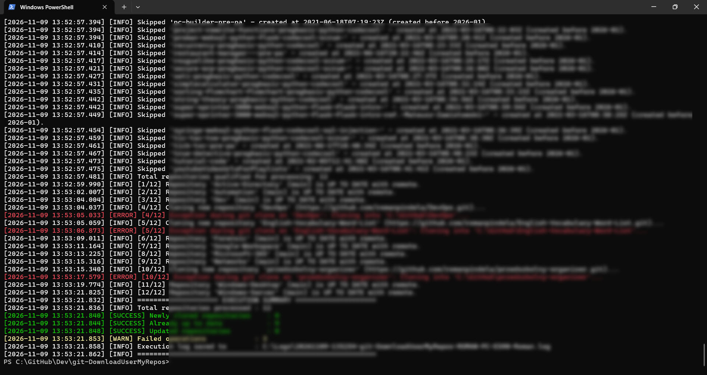

# Sync-GitHubUserRepos 📦

[](https://opensource.org/licenses/MIT)
[]()
[]()
[]()

## Problem Statement

Backing up, archiving, or selectively mirroring all GitHub repositories owned by a user account or email address manually is slow and error-prone—especially when filtering projects by creation or last-update dates, checking which local copies are behind remote commits, and handling private repositories with PAT authentication.

## Overview

`Sync-GitHubUserRepos.ps1` queries the GitHub REST API (with pagination and optional email-to-username resolution) to list repositories for a target account, filters them by fork status and flexible date ranges (`-CreatedBefore`, `-CreatedAfter`, `-UpdatedBefore`, `-UpdatedAfter`), clones missing repositories via HTTPS or SSH, checks whether existing local repositories are behind remote commits, and updates outdated repositories when `-Update` is specified while writing timestamped UTF-8 logs.

## Environment & Prerequisites

| Component | Requirement |
| :--- | :--- |
| **Operating System** | Windows 10, Windows 11, or Windows Server 2016+ (x64) |
| **Shell Environment** | Windows PowerShell 5.1 or PowerShell 7+ |
| **Git Engine** | [Git for Windows](https://git-scm.com/) installed and available in `$env:PATH` |
| **Network Access** | Outbound access to `api.github.com` (REST API) and `github.com` (HTTPS / SSH port 22) |
| **GitHub Credentials** | Optional Personal Access Token (PAT) as `SecureString` (`repo` scope for private repos and 5,000 req/h limit) |

## Permissions Required

**User** — Runs in standard user context; requires write permissions to `-DestinationPath` (default: `c:\Dane\rpindela\GitHub\BackupRepos`) and `-LogDirectory` (default: `C:\Logs`; pass a user-writable `-LogDirectory` or run elevated if creating folders in `C:\` root is restricted by system permissions).

## Safety & Impact

- **Risk Level:** `Modifies local directories & Git repositories` — Creates `-DestinationPath` and `-LogDirectory` if missing, clones matching repositories, runs `git fetch` on existing repositories, and executes `git pull` only when `-Update` is explicitly passed (otherwise reports outdated repositories as warnings without modifying local working trees). Masks PAT tokens in log output.
- **WhatIf / Confirm & Logs:** Does not support `-WhatIf` / `-Confirm` and creates no backups before `git pull`. Running without `-UserName` or with `-Help` / `-h` displays help safely without network or disk changes. Creates timestamped UTF-8 logs in `C:\Logs\<yyyyMMdd-HHmmss>-Sync-GitHubUserRepos-<COMPUTERNAME>-<USERNAME>.log` (or custom `-LogDirectory`).

## Usage Examples

```powershell
# Display built-in help (empty run or -Help / -h)
.\Sync-GitHubUserRepos.ps1
.\Sync-GitHubUserRepos.ps1 -h

# Display PowerShell Comment-Based Help
Get-Help .\Sync-GitHubUserRepos.ps1 -Full

# Verify and clone repositories by email address
.\Sync-GitHubUserRepos.ps1 -UserName "roman.pindela@gmail.com"

# Download only repositories created before or in year 2023
.\Sync-GitHubUserRepos.ps1 -UserName "roman.pindela@gmail.com" -CreatedBefore "2023"

# Filter by month and year (created before May 2023 and updated before June 2024)
.\Sync-GitHubUserRepos.ps1 `
    -UserName "roman.pindela@gmail.com" `
    -CreatedBefore "2023-05" `
    -UpdatedBefore "2024-06"

# Filter by exact date and update existing outdated repositories
.\Sync-GitHubUserRepos.ps1 `
    -UserName "roman.pindela@gmail.com" `
    -CreatedBefore "2023-12-31" `
    -UpdatedBefore "2024-06-30" `
    -Update

# Authenticate with PAT for private repositories
$token = Read-Host "Enter GitHub PAT" -AsSecureString
.\Sync-GitHubUserRepos.ps1 `
    -UserName "roman.pindela@gmail.com" `
    -GitHubToken $token `
    -CreatedBefore "2024" `
    -Update
```

### Parameter Reference

| Parameter | Type | Required | Default Value | Description |
| :--- | :--- | :---: | :--- | :--- |
| `-UserName` | `[string]` | **Yes** | *None* | GitHub username or email address (e.g. `roman.pindela@gmail.com`). Aliases: `-User`, `-Email`. |
| `-DestinationPath` | `[string]` | No | `c:\Dane\rpindela\GitHub\BackupRepos` | Local target directory where repositories are saved. Aliases: `-p`, `-Path`, `-Destination`. |
| `-GitHubToken` | `[SecureString]` | No | `$null` | Personal Access Token (PAT) for private repositories and higher API rate limits. Aliases: `-t`, `-Token`. |
| `-CloneProtocol` | `[string]` | No | `'HTTPS'` | Git clone transport protocol: `'HTTPS'` or `'SSH'`. Aliases: `-proto`, `-Protocol`. |
| `-Update` | `[switch]` | No | `$false` | If specified, updates existing repositories that are outdated. Aliases: `-SyncExisting`, `-Sync`, `-u`. |
| `-CreatedBefore` | `[string]` | No | *None* | Filter repositories created before or in the specified date/year/month. Aliases: `-CreatedDate`, `-CreatedUntil`, `-Created`, `-CreatedYear`. |
| `-UpdatedBefore` | `[string]` | No | *None* | Filter repositories updated before or in the specified date/year/month. Aliases: `-UpdatedDate`, `-UpdatedUntil`, `-Updated`, `-UpdatedYear`. |
| `-CreatedAfter` | `[string]` | No | *None* | Filter repositories created on or after the specified date. Alias: `-CreatedSince`. |
| `-UpdatedAfter` | `[string]` | No | *None* | Filter repositories updated on or after the specified date. Alias: `-UpdatedSince`. |
| `-IncludeForks` | `[switch]` | No | `$true` | Specifies whether to include forked repositories. Alias: `-forks`. |
| `-LogDirectory` | `[string]` | No | `C:\Logs` | Destination directory where timestamped execution log files are stored. Aliases: `-l`, `-Log`. |
| `-Help` | `[switch]` | No | `$false` | Displays help guide, parameter documentation, and examples. Alias: `-h`. |

---

## Directory Structure

```text
c:\Dane\rpindela\GitHub\Dev\
└── Sync-GitHubUserRepos\
    ├── assets/
    │   ├── help_run.jpg              # Help guide and script metadata
    │   ├── help_run2.jpg             # Parameter guide and practical examples
    │   └── Standard_run.jpg          # Standard script execution with parameters
    ├── Sync-GitHubUserRepos.ps1      # Production PowerShell automation script
    └── README.md                     # Documentation and operational guide
```

---

## Date Filtering Formats

The date filter parameters (`-CreatedBefore`, `-UpdatedBefore`, `-CreatedAfter`, `-UpdatedAfter`) accept:
1. **Year only (`YYYY`):** e.g. `"2023"` -> `2023-12-31 23:59:59 UTC` (`-Before`) or `2023-01-01 00:00:00 UTC` (`-After`).
2. **Month and Year (`YYYY-MM` or `MM.YYYY`):** e.g. `"2024-05"` -> end or start of that month in UTC.
3. **Full Date (`YYYY-MM-DD` or `DD.MM.YYYY`):** e.g. `"2023-12-31"`.

---

## Event Logging & Telemetry

Every execution writes a UTF-8 log file:
```text
C:\Logs\<yyyyMMdd-HHmmss>-Sync-GitHubUserRepos-<COMPUTERNAME>-<USERNAME>.log
```
With `[yyyy-MM-dd HH:mm:ss.fff] [<LEVEL>] <Message>` entries (`INFO`, `SUCCESS`, `WARN`, `ERROR`).

---

## Troubleshooting & Error Codes

| Error Condition | Cause | Resolution |
| :--- | :--- | :--- |
| **Command 'git' not found** | Git is not installed or not present in `$env:PATH`. | Install Git for Windows and ensure `git` is in system PATH. |
| **HTTP 401 Unauthorized** | Invalid or expired GitHub Personal Access Token. | Regenerate a PAT in GitHub Settings -> Developer Settings -> Personal access tokens. |
| **HTTP 403 Forbidden** | GitHub API rate limit exceeded (60 req/h unauthenticated). | Provide a GitHub PAT via `-GitHubToken` for 5,000 requests/hour. |
| **HTTP 404 Not Found** | GitHub user does not exist. | Verify spelling of `-UserName`. |
| **Git Clone / Pull Permission Denied (SSH)** | Missing or unassociated SSH key. | Ensure `ssh-agent` has your key (`ssh-add -l`) and public key is registered on GitHub. |

---

## Screenshots

### Help Menu & Script Metadata (`.\Sync-GitHubUserRepos.ps1 -h`)


### Parameter Usage & Execution Examples (`.\Sync-GitHubUserRepos.ps1 -Help`)


### Standard Execution & Verification


---

## Author

- **Roman Pindela**
- **Email:** [roman.pindela@gmail.com](mailto:roman.pindela@gmail.com)
- **GitHub:** [https://github.com/romanpindela](https://github.com/romanpindela)
- **Repository:** [https://github.com/romanpindela/Dev](https://github.com/romanpindela/Dev)
- **Version:** `1.2.0`
- **Release Date:** November 2026
- **License:** MIT
