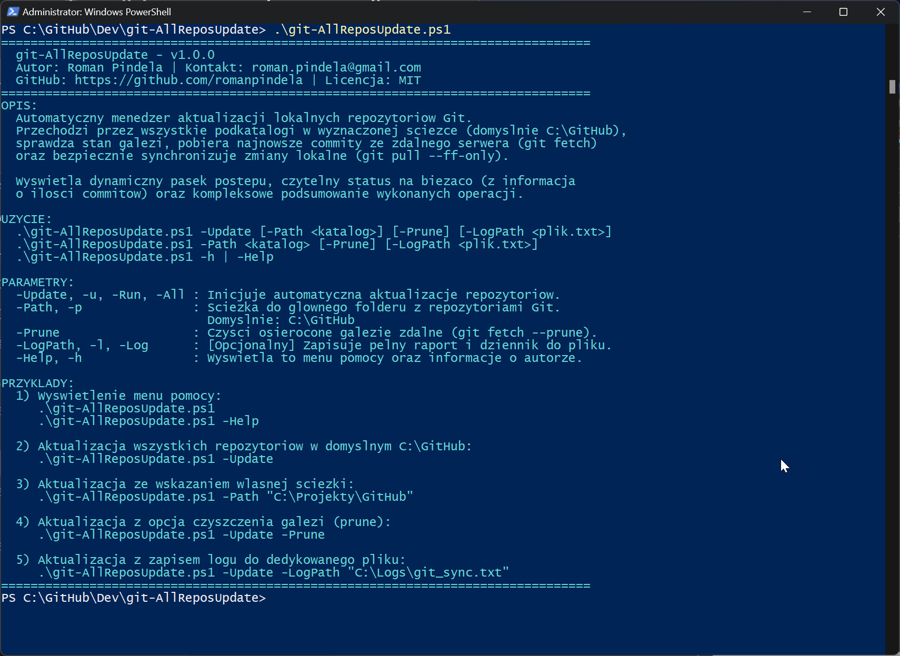
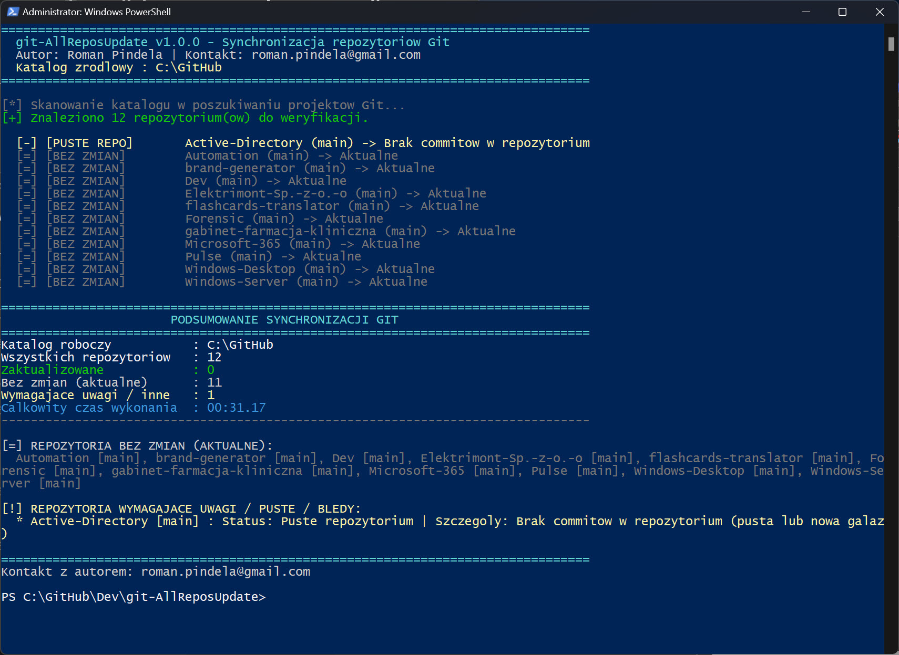

# Update-AllGitRepos 🔄

[](https://opensource.org/licenses/MIT)
[]()
[]()
[]()

## Problem Statement

Developers and administrators commonly keep dozens of cloned Git repositories under a single root folder (such as `C:\GitHub`). Manually entering each repository directory to check the active branch, run `git fetch`, fast-forward changes, and spot diverged or untracked branches is slow and error-prone.

## Overview

`Update-AllGitRepos.ps1` scans a parent directory (default: `C:\GitHub`) for subdirectories containing `.git`, checks branch and upstream tracking status, fetches remote updates (optionally pruning deleted branches with `-Prune`), safely fast-forwards behind branches via `git pull --ff-only`, displays a real-time `Write-Progress` bar with pulled commit counts, and summarizes results with optional UTF-8 file logging.

## Environment & Prerequisites

| Component | Requirement |
| :--- | :--- |
| **Operating System** | Windows 10, Windows 11, or Windows Server 2016+ (x64) |
| **Shell Environment** | Windows PowerShell 5.1 or PowerShell 7+ |
| **Git Engine** | [Git for Windows](https://git-scm.com/) installed and available in `$env:PATH` |
| **Git Credentials** | Configured Git Credential Manager (GCM) or SSH keys for remote access |

## Permissions Required

**User** — Scans and updates repositories inside user-accessible directories (`C:\GitHub` by default); no Administrator privileges are required.

## Safety & Impact

- **Risk Level:** `Modifies local Git repositories (fast-forward only)` — Runs `git fetch` (with `--prune` when `-Prune` is set) and `git pull --ff-only`, preventing accidental merge commits and reporting diverged, unborn, or detached/no-upstream repositories without forcing merges or rebases.
- **WhatIf / Confirm & Logs:** Does not support `-WhatIf` / `-Confirm` and creates no backups. Running without parameters or with `-Help` displays the help menu safely without altering repositories. Optionally writes a timestamped UTF-8 report to `-LogPath`.

## Usage Examples

```powershell
# Display built-in help (empty run or -Help / -h)
.\Update-AllGitRepos.ps1
.\Update-AllGitRepos.ps1 -Help

# Display PowerShell Comment-Based Help
Get-Help .\Update-AllGitRepos.ps1 -Full

# Update all repositories in default directory C:\GitHub
.\Update-AllGitRepos.ps1 -Update

# Update repositories in a custom directory
.\Update-AllGitRepos.ps1 -Path "D:\Workspace\Projects"

# Update repositories and prune deleted remote-tracking branches
.\Update-AllGitRepos.ps1 -Update -Prune

# Update repositories and write a UTF-8 log report
.\Update-AllGitRepos.ps1 -Update -Prune -LogPath "C:\Logs\git-update-$(Get-Date -Format 'yyyyMMdd_HHmmss').txt"
```

### Parameter Reference

| Parameter | Aliases | Type | Default Value | Description |
| :--- | :--- | :--- | :--- | :--- |
| `-Update` | `-u`, `-Run`, `-All` | Switch | `$false` | Initiates repository verification and update procedure. |
| `-Path` | `-p` | String | `C:\GitHub` | Parent directory containing Git project folders. |
| `-Prune` | *(none)* | Switch | `$false` | Enables pruning of deleted remote branches (`git fetch --prune`). |
| `-LogPath` | `-l`, `-Log` | String | `$null` | Optional file path for detailed text execution log. |
| `-Help` | `-h` | Switch | `$false` | Displays help menu and author information. |

---

## Directory Structure

```text
C:\GitHub\Dev\Update-AllGitRepos\
│
├── assets/
│   ├── Standard_run.jpg        # Default run view / help menu
│   └── Updating_repos.jpg      # Update process and summary view
├── Update-AllGitRepos.ps1      # Main PowerShell automation script
└── README.md                   # Technical documentation
```

---

## Status Reporting & Interpretation

| Console Tag | Meaning |
| :--- | :--- |
| `[UPDATED]` *(Green)* | New commits detected on remote and successfully fast-forwarded (`+N commit(s)`). |
| `[UP TO DATE]` *(Gray)* | Local branch is completely synchronized with remote tracking branch. |
| `[UP TO DATE] (Local Ahead)` *(Gray)* | No remote commits to pull, but local branch has commits waiting to be pushed (`git push`). |
| `[NO UPSTREAM]` *(Yellow)* | Current branch does not track any remote branch (`@{u}`). |
| `[NO REMOTE]` *(Yellow)* | No remote origin is configured in the repository. |
| `[PULL ERROR]` *(Red)* | Fast-forward pull failed (`git pull --ff-only`), e.g., diverged history, merge conflicts, or local uncommitted changes. |
| `[FETCH ERROR]` *(Red)* | Network issue, authentication failure, or inaccessible remote server. |

---

## Safety Architecture (Fast-Forward Only)

The script strictly runs `git pull --ff-only`, ensuring:
1. **No Accidental Merge Commits:** Diverged histories are never auto-merged.
2. **Local Experiment Protection:** Divergent local branches are preserved and flagged for review.
3. **Idempotence:** Safe to run repeatedly across all repositories.

---

## Event Logging

When `-LogPath` is provided, missing parent directories are created automatically and every message is written in UTF-8 with `[yyyy-MM-dd HH:mm:ss]` timestamps.

---

## Screenshots

### Standard Run (Help Menu / No Parameters)


### Repository Update Process (-Update)


---

## Author

- **Roman Pindela**
- **Email:** [roman.pindela@gmail.com](mailto:roman.pindela@gmail.com)
- **GitHub:** [https://github.com/romanpindela](https://github.com/romanpindela)
- **Version:** `1.0.0`
- **Release Date:** October 2026
- **License:** MIT
