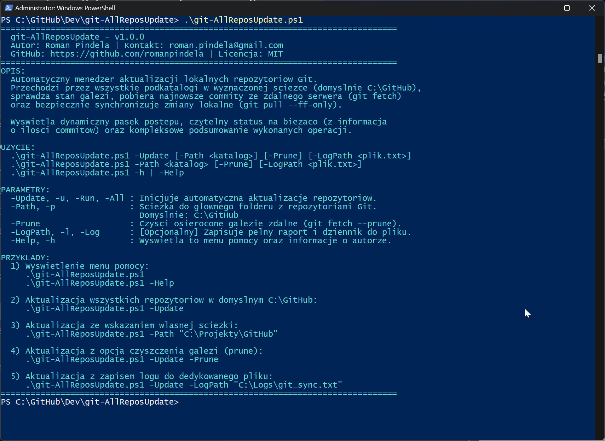
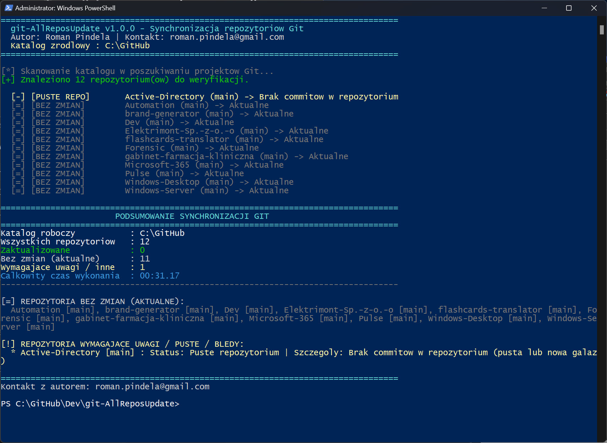

# git-AllReposUpdate 🔄

[](https://opensource.org/licenses/MIT)
[]()
[]()
[]()

Zaawansowany, produkcyjny skrypt PowerShell automatyzujący proces masowej weryfikacji, synchronizacji i aktualizacji wszystkich lokalnych repozytoriów Git znajdujących się we wskazanym katalogu roboczym (domyślnie `C:\GitHub`).

---

## 📌 Metadane i autorstwo

* **Autor:** Roman Pindela
* **E-mail:** [roman.pindela@gmail.com](mailto:roman.pindela@gmail.com)
* **GitHub:** [https://github.com/romanpindela](https://github.com/romanpindela)
* **Wersja:** `1.0.0`
* **Data wydania:** Październik 2026
* **Licencja:** MIT

---

## 📋 Spis treści

1. [Przeznaczenie narzędzia](#1-przeznaczenie-narzędzia)
2. [Główne funkcjonalności](#2-główne-funkcjonalności)
3. [Wymagania systemowe](#3-wymagania-systemowe)
4. [Struktura katalogu](#4-struktura-katalogu)
5. [Tabela parametrów](#5-tabela-parametrów)
6. [Przykłady użycia](#6-przykłady-użycia)
7. [Raportowanie i interpretacja statusów](#7-raportowanie-i-interpretacja-statusów)
8. [Architektura bezpieczeństwa (Fast-Forward Only)](#8-architektura-bezpieczeństwa-fast-forward-only)
9. [Rejestracja zdarzeń (Logowanie)](#9-rejestracja-zdarzeń-logowanie)
10. [Zrzuty ekranu (Screenshots)](#10-zrzuty-ekranu-screenshots)

---

## 1. Przeznaczenie narzędzia

Podczas codziennej pracy inżynierskiej i programistycznej na stacji roboczej deweloper często posiada kilkanaście lub kilkadziesiąt sklonowanych repozytoriów w jednym nadrzędnym folderze (np. `C:\GitHub`). Ręczne przechodzenie do każdego katalogu w celu wykonania poleceń `git fetch` i `git pull` jest czasochłonne i podatne na błędy ludzkie.

Skrypt `git-AllReposUpdate.ps1` w sposób w pełni automatyczny, idempotentny i bezpieczny:
1. Przeszukuje zadany katalog w poszukiwaniu podfolderów zawierających metadane `.git`.
2. Bada stan bieżącej gałęzi oraz skonfigurowany upstream (tracking branch).
3. Pobiera najnowsze zmiany z serwera (`git fetch`).
4. Bezpiecznie aktualizuje gałąź lokalną (`git pull --ff-only`), gwarantując brak tworzenia niepożądanych commitów scalających (merge commits).
5. Prezentuje czytelny pasek postępu (`Write-Progress`) oraz szczegółowe zestawienie podsumowujące.

---

## 2. Główne funkcjonalności

- 🛡️ **Bezpieczne uruchomienie domyślne (Empty-Run Safeguard):** Uruchomienie skryptu bez jakichkolwiek parametrów nie wykonuje modyfikacji – wyświetla czytelne menu pomocy, wersję, dane autora oraz przykłady użycia.
- 📊 **Dynamiczny pasek postępu:** Wykorzystuje natywne polecenie PowerShell `Write-Progress` ze wskazaniem aktualnie przetwarzanego projektu oraz procentowego stanu ukończenia.
- 🔍 **Precyzyjny licznik commitów:** W przypadku aktualizacji repozytorium skrypt raportuje dokładną liczbę pobranych commitów (`+N commit(ów)`) oraz wyświetla skróty najnowszych wpisów z historii (`git log --oneline`).
- ⚡ **Wsparcie dla czyszczenia gałęzi (`-Prune`):** Opcjonalne usuwanie nieaktualnych zdalnych referencji gałęzi (`git fetch --prune`).
- 📝 **Moduł rejestrowania zdarzeń (`-LogPath`):** Możliwość równoległego zapisu przebiegu operacji do pliku tekstowego z precyzyjnymi znacznikami czasu.
- 🎨 **Kolorystyka konsoli:** Spójne kodowanie kolorami (zielony = sukces/aktualizacja, szary = brak zmian, żółty = ostrzeżenie/ahead, czerwony = błąd).

---

## 3. Wymagania systemowe

| Komponent | Wymaganie |
| :--- | :--- |
| **System operacyjny** | Windows 10, Windows 11 lub Windows Server 2016+ (x64) |
| **Środowisko powłoki** | Windows PowerShell 5.1 lub PowerShell 7+ |
| **Silnik Git** | [Git for Windows](https://git-scm.com/) zainstalowany i dostępny w zmiennej `$env:PATH` |
| **Poświadczenia Git** | Skonfigurowany Git Credential Manager (GCM) lub klucze SSH dla operacji pobierania z GitHub |

---

## 4. Struktura katalogu

```text
C:\GitHub\Dev\git-AllReposUpdate\
│
├── assets/
│   ├── Standard_run.jpg        # Widok uruchomienia domyślnego / menu pomocy
│   └── Updating_repos.jpg      # Widok procesu aktualizacji i podsumowania
├── git-AllReposUpdate.ps1      # Główny skrypt automatyzacji PowerShell
└── README.md                  # Niniejsza dokumentacja techniczna
```

---

## 5. Tabela parametrów

| Parametr | Aliases | Typ | Wartość domyślna | Opis |
| :--- | :--- | :--- | :--- | :--- |
| `-Update` | `-u`, `-Run`, `-All` | Switch | `$false` | Inicjuje procedurę sprawdzania i aktualizacji repozytoriów. |
| `-Path` | `-p` | String | `C:\GitHub` | Ścieżka nadrzędna zawierająca katalogi projektów Git. |
| `-Prune` | *(brak)* | Switch | `$false` | Włącza czyszczenie usuniętych gałęzi zdalnych (`git fetch --prune`). |
| `-LogPath` | `-l`, `-Log` | String | `$null` | Opcjonalna ścieżka do pliku raportu tekstowego. |
| `-Help` | `-h` | Switch | `$false` | Wymusza wyświetlenie menu pomocy oraz informacji o autorze. |

---

## 6. Przykłady użycia

### 1) Uruchomienie domyślne (Wyświetlenie menu pomocy)
Uruchomienie skryptu bez parametrów lub z przełącznikiem `-Help` wyświetla pełną dokumentację w oknie konsoli:
```powershell
.\git-AllReposUpdate.ps1
# lub
.\git-AllReposUpdate.ps1 -Help
```

### 2) Standardowa aktualizacja wszystkich repozytoriów
Skanuje domyślny folder `C:\GitHub` i synchronizuje wszystkie projekty:
```powershell
.\git-AllReposUpdate.ps1 -Update
```

### 3) Aktualizacja repozytoriów w niestandardowej ścieżce
Wskazanie alternatywnego folderu nadrzędnego:
```powershell
.\git-AllReposUpdate.ps1 -Path "D:\Workspace\Projekty"
```

### 4) Aktualizacja z czyszczeniem gałęzi zdalnych (Prune)
Usuwa lokalne referencje do gałęzi usuniętych z serwera GitHub:
```powershell
.\git-AllReposUpdate.ps1 -Update -Prune
```

### 5) Pełna synchronizacja z zapisem logu do pliku
Generuje szczegółowy raport w wybranym pliku tekstowym:
```powershell
.\git-AllReposUpdate.ps1 -Update -Prune -LogPath "C:\Logs\git-update-$(Get-Date -Format 'yyyyMMdd_HHmmss').txt"
```

---

## 7. Raportowanie i interpretacja statusów

W trakcie działania skrypt oznacza każde repozytorium jednym z jednoznacznych stanów:

| Oznaczenie w konsoli | Znaczenie biznesowe |
| :--- | :--- |
| `[ZAKTUALIZOWANO]` *(Zielony)* | Wykryto nowe commity na serwerze zdalnym i pomyślnie zsynchronizowano je z gałęzią lokalną (`+N commitów`). |
| `[BEZ ZMIAN]` *(Szary)* | Gałąź lokalna jest w pełni zgodna z gałęzią śledzącą na serwerze zdalnym. |
| `[BEZ ZMIAN] (Lokalnie)` *(Szary)* | Gałąź lokalna nie ma nowych commitów do pobrania, ale posiada lokalne commity oczekujące na wysłanie (`git push`). |
| `[BRAK UPSTREAM]` *(Żółty)* | Bieżąca gałąź nie posiada powiązania ze zdalną gałęzią śledzącą (`@{u}`). |
| `[BRAK REMOTE]` *(Żółty)* | W repozytorium nie skonfigurowano żadnego zdalnego serwera (`remote origin`). |
| `[BŁĄD PULL]` *(Czerwony)* | Operacja `git pull --ff-only` nie mogła zostać ukończona (np. rozbieżność historii, konflikty plików lub modyfikacje w roboczym drzewie). |
| `[BŁĄD FETCH]` *(Czerwony)* | Błąd sieciowy, autoryzacyjny lub brak dostępu do serwera zdalnego. |

### Przykładowy widok podsumowania końcowego:
```text
================================================================================
                       PODSUMOWANIE SYNCHRONIZACJI GIT                          
================================================================================
Katalog roboczy           : C:\GitHub
Wszystkich repozytoriow   : 12
Zaktualizowane            : 1
Bez zmian (aktualne)      : 11
Wymagajace uwagi / bledy  : 0
Calkowity czas wykonania  : 00:08.45
--------------------------------------------------------------------------------

[+] REPOZYTORIA ZAKTUALIZOWANE:
  * Dev [main] : pobrano 2 commit(ow)
      - a1b2c3d feat(core): implement new telemetry collector
      - d4e5f6g fix(parser): resolve json escaping edge case

[=] REPOZYTORIA BEZ ZMIAN (AKTUALNE):
  Active-Directory [main], Automation [main], brand-generator [main], Elektrimont-Sp.-z-o.-o [main],
  flashcards-translator [main], Forensic [main], gabinet-farmacja-kliniczna [main], Microsoft-365 [main],
  Pulse [main], Windows-Desktop [main], Windows-Server [main]

================================================================================
Kontakt z autorem: roman.pindela@gmail.com
```

---

## 8. Architektura bezpieczeństwa (Fast-Forward Only)

Skrypt wykorzystuje flagę:
```bash
git pull --ff-only
```
Jest to celowa decyzja architektoniczna chroniąca integralność Twojego repozytorium:
1. **Brak niechcianych commitów scalających:** W przypadku braku możliwości czystego przesunięcia wskaźnika w przód (fast-forward), Git nie utworzy automatycznego commita `Merge branch '...'`.
2. **Ochrona lokalnych zmian:** Jeśli na stacji roboczej prowadzisz eksperymenty lub posiadasz rozbieżne commity, skrypt nie wymusi scalenia ani rebase – zaraportuje stan w podsumowaniu, pozostawiając decyzję administratorowi.
3. **Idempotentność:** Wielokrotne uruchomienie skryptu w dowolnym momencie jest w 100% bezpieczne dla wszystkich repozytoriów.

---

## 9. Rejestracja zdarzeń (Logowanie)

Po przekazaniu parametru `-LogPath` skrypt:
- Automatycznie tworzy brakujące katalogi nadrzędne dla pliku dziennika.
- Zapisuje każdy komunikat w formacie kodowania `UTF-8` wraz ze stemplem czasowym `[yyyy-MM-dd HH:mm:ss]`.
- Nie blokuje potoku konsoli i nie przerywa działania w razie problemów z uprawnieniami do zapisu.

---

## 10. Zrzuty ekranu (Screenshots)

### Standard Run (Menu pomocy / Uruchomienie bez parametrów)


### Przebieg aktualizacji repozytoriów (-Update)

