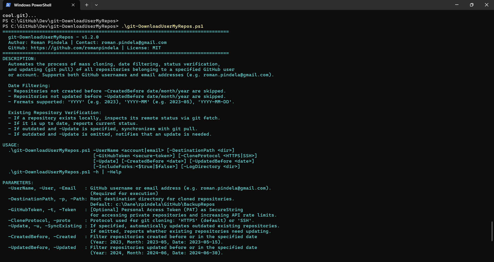
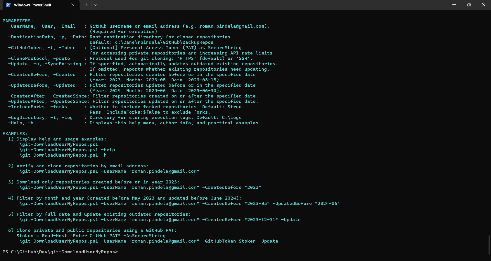
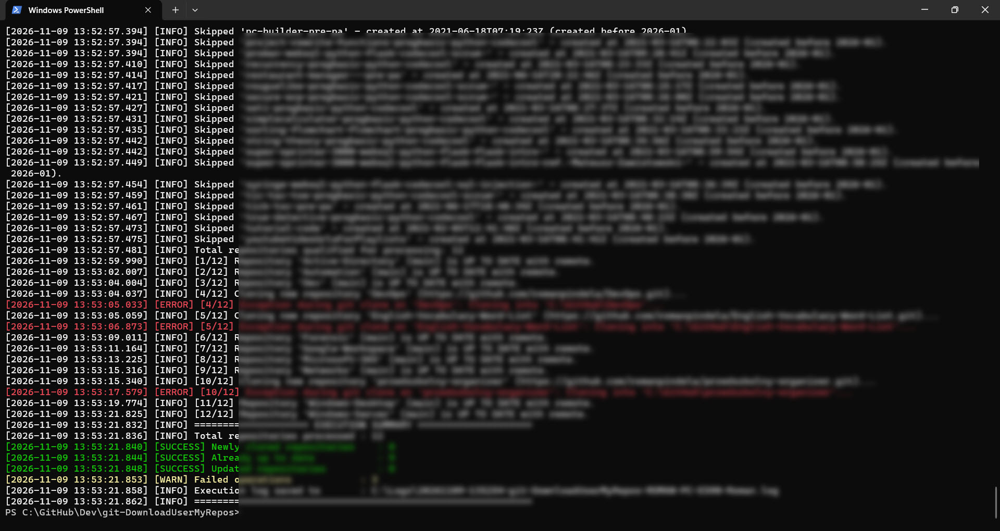

# git-DownloadUserMyRepos 📦

[](https://opensource.org/licenses/MIT)
[]()
[]()
[]()

Production-grade PowerShell automation script for mass cloning, status verification, date filtering, and synchronization (`git pull`) of all GitHub repositories owned by a designated user or organization account.

---

## 📌 Metadata & Author Information

* **Author:** Roman Pindela
* **Email:** [roman.pindela@gmail.com](mailto:roman.pindela@gmail.com)
* **GitHub:** [https://github.com/romanpindela](https://github.com/romanpindela)
* **Repository:** [https://github.com/romanpindela/Dev](https://github.com/romanpindela/Dev)
* **Script Path:** `git-DownloadUserMyRepos\git-DownloadUserMyRepos.ps1`
* **Version:** `1.2.0`
* **Release Date:** November 2026
* **License:** MIT

---

## 📋 Table of Contents

1. [Tool Purpose](#1-tool-purpose)
2. [Key Features](#2-key-features)
3. [System Requirements](#3-system-requirements)
4. [Workflow & Architecture](#4-workflow--architecture)
5. [Directory Structure](#5-directory-structure)
6. [Parameter Reference](#6-parameter-reference)
7. [Date Filtering Formats](#7-date-filtering-formats)
8. [Usage Examples](#8-usage-examples)
9. [Event Logging & Telemetry](#9-event-logging--telemetry)
10. [Troubleshooting & Error Codes](#10-troubleshooting--error-codes)
11. [Screenshots](#11-screenshots)

---

## 1. Tool Purpose

Developers and DevOps engineers often need to back up, archive, or selectively replicate repositories belonging to a personal GitHub account or organization. Manually inspecting dozens or hundreds of projects to verify creation dates, update activity, or synchronization status is tedious and prone to human error.

`git-DownloadUserMyRepos.ps1` provides an automated, resilient, and enterprise-ready solution:
- Accepts either a **GitHub username** or an **email address** (e.g. `roman.pindela@gmail.com`), automatically resolving the account using GitHub Search API.
- **Date Filtering:** Selectively downloads repositories based on when they were created (`-CreatedBefore` / `-CreatedAfter`) and when they were last updated (`-UpdatedBefore` / `-UpdatedAfter`). Repositories outside the criteria are safely skipped.
- **Intelligent Existing Repository Inspection:**
  - If a repository already exists locally in `DestinationPath`, it fetches remote references and verifies whether the local branch is up to date or behind remote commits.
  - If it is up to date, it confirms and logs that no action is needed.
  - If it is outdated and `-Update` is specified, it automatically synchronizes changes (`git pull`).
  - If it is outdated and `-Update` is omitted, it displays an informative warning that the repository exists locally but needs to be updated.
- Offers dual transport protocol support: HTTPS (with secure token masking) and SSH (`git@github.com:...`).
- Provides real-time visual progress reporting (`Write-Progress`) and centralized UTF-8 event logging.

---

## 2. Key Features

- 📧 **Direct Email Resolution:** Accepts an email address (e.g., `roman.pindela@gmail.com`) as `-UserName` or `-Email`, accurately mapping it to the corresponding GitHub user.
- 📅 **Flexible Date Filtering:** Filter by creation date (`-CreatedBefore`) and last update date (`-UpdatedBefore`) using Year (`2023`), Month & Year (`2023-05`), or full date (`2023-05-15`).
- 🔍 **Up-to-Date Verification:** Checks whether local copies are synchronized with remote commits before performing any modifications.
- 🔄 **Safe Conditional Updating (`-Update`):** Only updates outdated repositories when `-Update` is explicitly provided, preventing unintended local file changes.
- 🔐 **Secure PAT Integration:** Accepts GitHub Personal Access Tokens as `SecureString` to keep tokens out of command history and masks credentials in log output.
- 🔀 **Flexible Protocol Selection:** Toggle between `HTTPS` and `SSH` transport protocols via `-CloneProtocol`.
- 🍴 **Fork Filtering:** Control whether to clone forked repositories or focus exclusively on original codebases (`-IncludeForks`).
- 📊 **Dynamic Visual Feedback:** Displays `Write-Progress` status bar and color-coded status messages.
- 📝 **Centralized Event Logging:** Logs operations to `C:\Logs\<yyyyMMdd-HHmmss>-git-DownloadUserMyRepos-<COMPUTERNAME>-<USERNAME>.log` with millisecond-precision timestamps.
- ⚙️ **Dual-Compatibility:** Engineered and validated for both Windows PowerShell 5.1 and modern PowerShell 7+.

---

## 3. System Requirements

| Component | Requirement |
| :--- | :--- |
| **Operating System** | Windows 10, Windows 11, or Windows Server 2016+ (x64) |
| **Shell Environment** | Windows PowerShell 5.1 or PowerShell 7+ |
| **Git Engine** | [Git for Windows](https://git-scm.com/) installed and available in `$env:PATH` |
| **Network Access** | Outbound access to `api.github.com` (REST API) and `github.com` (HTTPS / SSH port 22) |
| **GitHub Credentials** | Optional Personal Access Token (PAT) with `repo` scope for private repositories |

---

## 4. Workflow & Architecture

```text
[Start]
  │
  ├── 1. Argument validation:
  │        ├── If -h, -Help or no arguments -> Display Show-HelpGuide and exit
  │        ├── If email passed -> Resolve email to GitHub username via Search API
  │        └── Parse date filters (-CreatedBefore, -UpdatedBefore, etc.)
  │
  ├── 2. Environment pre-check:
  │        ├── Check git.exe availability in PATH
  │        └── Create DestinationPath if it does not exist
  │
  ├── 3. Retrieve repository list (GitHub REST API):
  │        ├── Page loop (per_page=100)
  │        ├── Filter forks (if -IncludeForks:$false)
  │        └── Filter by date (CreatedBefore / UpdatedBefore cutoffs)
  │
  ├── 4. Foreach qualified repository:
  │        ├── If folder does NOT exist locally:
  │        │     └── Run git clone <URL>
  │        └── If folder DOES exist locally:
  │              ├── Check if valid Git repo (.git exists)
  │              ├── Run git fetch to update remote references
  │              ├── Calculate commits behind remote: rev-list HEAD..FETCH_HEAD --count
  │              ├── If behind == 0:
  │              │     └── Log [INFO]: Repository is UP TO DATE
  │              └── If behind > 0:
  │                    ├── If -Update -> Run git pull, Log [SUCCESS]: Updated
  │                    └── If no -Update -> Log [WARN]: Repository exists but IS OUTDATED
  │
  ├── 5. Execution Summary:
  │        └── Count cloned, up-to-date, updated, needs-update, and failed operations
  │
  └── [Stop] Write summary to central UTF-8 log file
```

---

## 5. Directory Structure

```text
c:\Dane\rpindela\GitHub\Dev\
└── git-DownloadUserMyRepos\
    ├── assets/
    │   ├── help_run.jpg               # Help guide and script metadata
    │   ├── help_run2.jpg              # Parameter guide and practical examples
    │   └── Standard_run.jpg           # Standard script execution with parameters
    ├── git-DownloadUserMyRepos.ps1    # Production PowerShell automation script
    └── README.md                      # Documentation and operational guide
```

---

## 6. Parameter Reference

| Parameter | Type | Required | Default Value | Description |
| :--- | :--- | :---: | :--- | :--- |
| `-UserName` | `[string]` | **Yes** | _None_ | GitHub username or email address (e.g. `roman.pindela@gmail.com`). Aliases: `-User`, `-Email`. |
| `-DestinationPath` | `[string]` | No | `c:\Dane\rpindela\GitHub\BackupRepos` | Local target directory where repositories are saved. Aliases: `-p`, `-Path`, `-Destination`. |
| `-GitHubToken` | `[SecureString]` | No | `$null` | Personal Access Token (PAT) for private repositories and higher API rate limits. Aliases: `-t`, `-Token`. |
| `-CloneProtocol` | `[string]` | No | `'HTTPS'` | Git clone transport protocol: `'HTTPS'` or `'SSH'`. Alias: `-proto`, `-Protocol`. |
| `-Update` | `[switch]` | No | `$false` | If specified, updates existing repositories that are outdated. Aliases: `-SyncExisting`, `-Sync`, `-u`. |
| `-CreatedBefore` | `[string]` | No | _None_ | Filter repositories created before or in the specified date/year/month. Aliases: `-CreatedDate`, `-CreatedUntil`, `-Created`. |
| `-UpdatedBefore` | `[string]` | No | _None_ | Filter repositories updated before or in the specified date/year/month. Aliases: `-UpdatedDate`, `-UpdatedUntil`, `-Updated`. |
| `-CreatedAfter` | `[string]` | No | _None_ | Filter repositories created on or after the specified date. Alias: `-CreatedSince`. |
| `-UpdatedAfter` | `[string]` | No | _None_ | Filter repositories updated on or after the specified date. Alias: `-UpdatedSince`. |
| `-IncludeForks` | `[switch]` | No | `$true` | Specifies whether to include forked repositories. Alias: `-forks`. |
| `-LogDirectory` | `[string]` | No | `C:\Logs` | Destination directory where timestamped execution log files are stored. Aliases: `-l`, `-Log`. |
| `-Help` | `[switch]` | No | `$false` | Displays help guide, parameter documentation, and examples. Alias: `-h`. |

---

## 7. Date Filtering Formats

The date filter parameters (`-CreatedBefore`, `-UpdatedBefore`, etc.) accept the following formats:

1. **Year only (`YYYY`):**
   - Example: `-CreatedBefore "2023"`
   - Evaluates to `2023-12-31 23:59:59 UTC`. Repositories created in 2023 or earlier are included; repositories created in 2024 or later are skipped.
2. **Month and Year (`YYYY-MM` or `MM.YYYY`):**
   - Example: `-CreatedBefore "2024-05"`
   - Evaluates to the last moment of that month (`2024-05-31 23:59:59 UTC`).
3. **Full Date (`YYYY-MM-DD` or `DD.MM.YYYY`):**
   - Example: `-CreatedBefore "2023-12-31"`
   - Evaluates to the end of that specific day (`2023-12-31 23:59:59 UTC`).

---

## 8. Usage Examples

### Example 1: Display help and metadata
```powershell
.\git-DownloadUserMyRepos.ps1 -h
```

### Example 2: Download only repositories created before or in year 2023
```powershell
.\git-DownloadUserMyRepos.ps1 -UserName "roman.pindela@gmail.com" -CreatedBefore "2023"
```

### Example 3: Filter by month and year (created before May 2023 and updated before June 2024)
```powershell
.\git-DownloadUserMyRepos.ps1 `
    -UserName "roman.pindela@gmail.com" `
    -CreatedBefore "2023-05" `
    -UpdatedBefore "2024-06"
```

### Example 4: Filter by exact date and update existing outdated repositories
```powershell
.\git-DownloadUserMyRepos.ps1 `
    -UserName "roman.pindela@gmail.com" `
    -CreatedBefore "2023-12-31" `
    -UpdatedBefore "2024-06-30" `
    -Update
```

### Example 5: Authenticate with PAT for private repositories
```powershell
$token = Read-Host "Enter GitHub PAT" -AsSecureString

.\git-DownloadUserMyRepos.ps1 `
    -UserName "roman.pindela@gmail.com" `
    -GitHubToken $token `
    -CreatedBefore "2024" `
    -Update
```

---

## 9. Event Logging & Telemetry

Every execution creates a unique log file formatted as:
```text
C:\Logs\<yyyyMMdd-HHmmss>-git-DownloadUserMyRepos-<COMPUTERNAME>-<USERNAME>.log
```

Log entry format:
```text
[yyyy-MM-dd HH:mm:ss.fff] [<LEVEL>] <Message>
```

Levels:
- `[INFO]`: Diagnostic messages, cutoff parameters, and up-to-date repository notifications.
- `[SUCCESS]`: Successful clone or synchronization operations.
- `[WARN]`: Outdated repositories (when `-Update` is not set) and skipped filter notices.
- `[ERROR]`: Execution failure, network fault, or Git exit code errors.

---

## 10. Troubleshooting & Error Codes

| Error Condition | Cause | Resolution |
| :--- | :--- | :--- |
| **Command 'git' not found** | Git is not installed or not present in `$env:PATH`. | Install Git for Windows and ensure `C:\Program Files\Git\cmd` is in system PATH. |
| **HTTP 401 Unauthorized** | Invalid or expired GitHub Personal Access Token. | Regenerate a new PAT in GitHub Settings -> Developer Settings -> Personal access tokens. |
| **HTTP 403 Forbidden** | GitHub API rate limit exceeded (60 req/h for unauthenticated requests). | Provide a GitHub PAT via `-GitHubToken` to expand the rate limit to 5,000 requests/hour. |
| **HTTP 404 Not Found** | GitHub user does not exist. | Verify spelling of the `-UserName` parameter. |
| **Git Clone / Pull Permission Denied (SSH)** | Missing or unassociated SSH private key. | Ensure OpenSSH agent is running (`ssh-add -l`) and public key is uploaded to GitHub. |

---

## 11. Screenshots

### Help Menu & Script Metadata (`.\git-DownloadUserMyRepos.ps1 -h`)


### Parameter Usage & Execution Examples (`.\git-DownloadUserMyRepos.ps1 -Help`)


### Standard Execution & Verification


---

## 📄 License

This project is licensed under the [MIT License](https://opensource.org/licenses/MIT).
